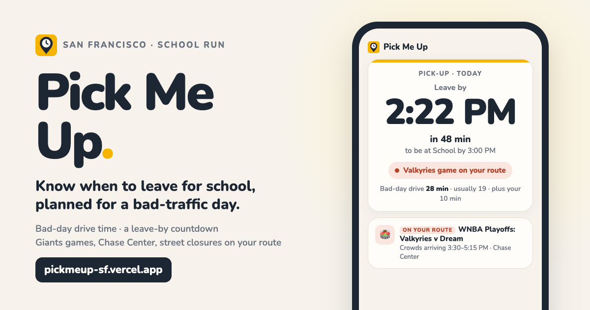

# Pick Me Up

**When to leave for school in San Francisco, planned for a bad-traffic day, and what's happening on your route.**

Live: **https://pickmeup-sf.vercel.app**



Made for a parent who does the school run almost every day and worries about being late for pick-up, because a Giants game, a concert at Chase Center or a street fair can turn a 12-minute drive into 30. Open it and it answers one question: *when do I leave?*

- **Leave-by time and countdown** for the next drop-off or pick-up, from Google's *pessimistic* traffic forecast for that exact departure time, plus the extra minutes you choose.
- **What's on your way:**
  - Giants home games
  - Warriors, Valkyries and concerts at Chase Center
  - events at Oracle Park, Bill Graham Civic, Moscone, Golden Gate Park and the Cow Palace
  - permitted street closures (races, fairs, block parties, construction)
  - live 511 incidents

  Each is checked against the times you'd be driving and the streets on your route. If something is on the route, the leave-by time moves 10 minutes earlier.
- **Coming up:** the next school days at a glance, with one tap to mark a day with no school.
- **Add to Home Screen** on iPhone for an app-like icon.

## Privacy

- **Settings:** your two places, school times and extra minutes are saved only in your browser (`localStorage`).
- **Drive times:** places go to Google Maps (via `/api/plan` and `/api/geocode`, in POST bodies, not URLs). They aren't logged or stored.
- **Events:** the events list (`/api/events?date=`) is the same for everyone. Your route is matched to events on your phone, so that server never learns where you live.
- **Map tiles:** these come from OpenStreetMap.

## How it works

| What | Source | Key |
| --- | --- | --- |
| Drive times, route | Google Routes API (`TRAFFIC_AWARE_OPTIMAL`, `PESSIMISTIC` and `BEST_GUESS`) | `GOOGLE_MAPS_API_KEY` |
| Address lookup | Google Geocoding API | same key |
| Giants home games | MLB Stats API | none |
| Arenas, stadiums, Moscone | Ticketmaster Discovery API | `TICKETMASTER_API_KEY` |
| Street closures | DataSF *Temporary Street Closures* | none |
| Incidents, roadwork (today) | 511.org traffic events | `TRAFFIC_511_API_KEY` |

- **When "crowds" count:** ends are rarely published. Crowd windows run from 2 hours before the start, and from about the estimated end to an hour after it. Estimated lengths are 3 h for baseball, 2.5 h for basketball and 3.5 h for concerts.
- **Your trip window:** from 15 minutes before you leave to 30 minutes after you arrive, which covers the drive home.
- **On your route vs. nearby:**
  - Venues are *on your route* within 800 m and *nearby* within 2 km.
  - Street closures count when they're on a street you drive. A fully closed street counts within 250 m.
  - 511 incidents are on your route within 150 m and nearby within 600 m.

### Code

- `public/`: the page (no build step): `app.js`, and `lib/` shared with the server: `geo.js` (polylines, distances), `time.js` (Pacific time), `impact.js` (route and time matching).
- `lib/events.mjs`: collects and normalizes the day's events. `lib/google.mjs`: geocoding and the leave-by plan.
- `api/`: Vercel functions (`events`, `geocode`, `plan`).
- `scripts/dev.mjs`: local server with the same headers as Vercel. `scripts/brand/make.mjs`: favicons and share image.

```sh
cp .env.example .env.local   # add your keys
npm test                     # node --test
npm run dev                  # http://localhost:3000
```

### Google Maps setup

In Google Cloud, enable **Routes API** and **Geocoding API**, then create an API key and restrict it to those two APIs. Each check of a trip costs about 3–4 Routes requests, and a lookup is reused for 5 minutes. Set a daily quota cap on the Routes API, for example 500 requests a day, so the public site can never run up a bill.

## Credits

Map data © OpenStreetMap contributors. Maps by [Leaflet](https://leafletjs.com) (BSD-2). Font: [Nunito](https://fonts.google.com/specimen/Nunito) (OFL). Not affiliated with any team, venue or agency. Times are estimates.

Built by [Nathan Nam](https://www.nathannam.com) with Claude Code.
